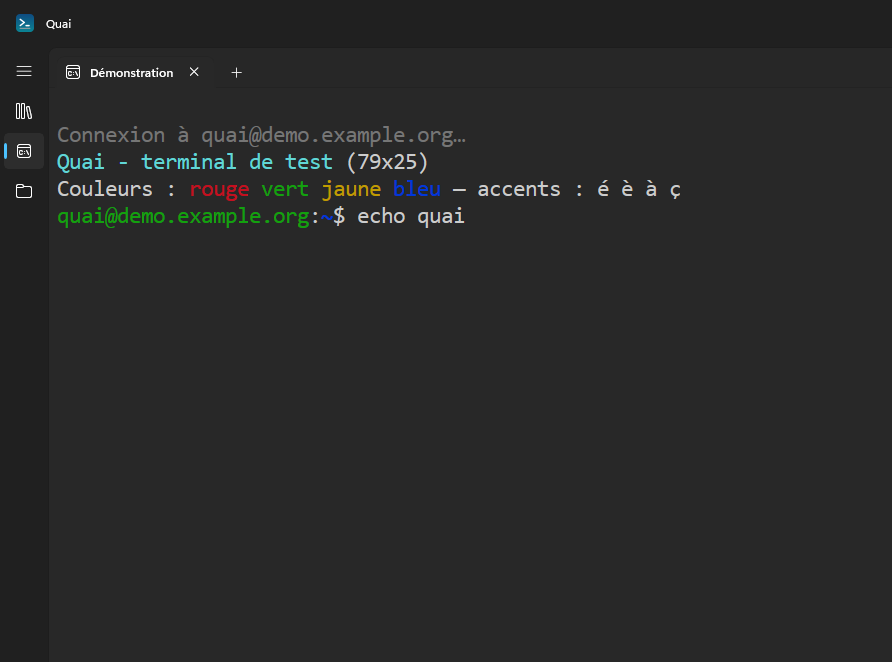
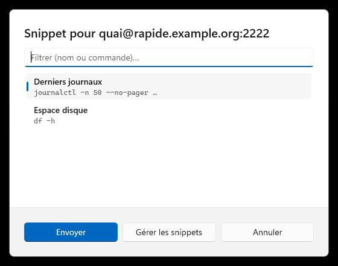
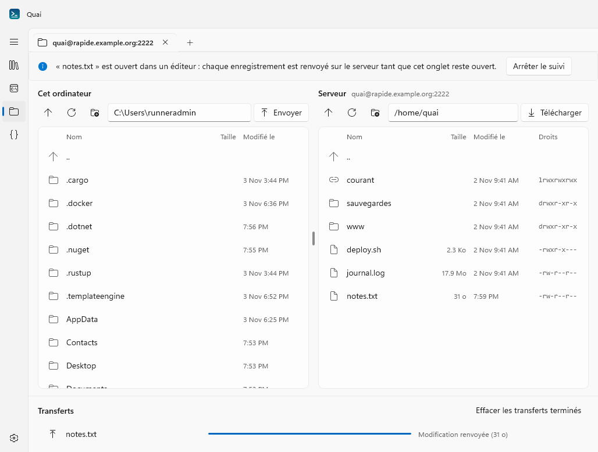
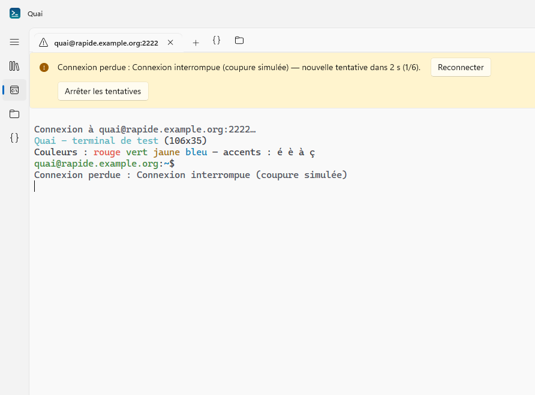

  

<h1 align="center">Quai SSH</h1>

  <b>Vos serveurs, vos fichiers et vos appareils, réunis dans une seule application Windows.</b> 
  Un client SSH et SFTP moderne, simple et gratuit, pensé pour Windows 11.

  <a href="https://github.com/memton80/quai-ssh/releases/latest"><b>Télécharger Quai SSH pour Windows</b></a>
  · Gratuit · Sans compte · Sans publicité

## Pourquoi Quai SSH ?

Se connecter à un serveur ne devrait pas demander trois logiciels et un post-it couvert de mots de passe. Quai SSH rassemble tout au même endroit, dans une fenêtre qui ressemble à Windows 11.

- **Tous vos serveurs, bien rangés.** Ajoutez une connexion une fois, retrouvez-la en un clic : dossiers, étiquettes et recherche instantanée.
- **Un vrai terminal, rapide et net.** Quai SSH utilise le moteur de Windows Terminal, celui de Microsoft. Plusieurs onglets, copier-coller comme d'habitude.
- **Votre PC aussi.** Le bouton « Terminal local » ouvre PowerShell, l'invite de commandes ou WSL dans un onglet, à côté de vos serveurs (`Ctrl+Maj+T`).
- **Vos fichiers par glisser-déposer.** Votre PC à gauche, le serveur à droite : faites glisser, c'est envoyé.
- **Aussi pour vos petits appareils.** Routeur, switch, Arduino, Raspberry Pi : branchez le câble, choisissez le port, c'est parti.
- **Toujours à jour, en un clic.** Quand une nouvelle version sort, un bouton suffit : Quai SSH se met à jour et redémarre tout seul.

## Moins de gestes répétitifs

**Connexion rapide.** Tapez `alice@serveur` dans le champ en haut du carnet et appuyez sur Entrée : le terminal s'ouvre, sans fiche à remplir. Si la connexion vous plaît, un bouton l'ajoute au carnet.

**Vos commandes favorites en deux touches.** Enregistrez une fois les commandes que vous tapez souvent, puis envoyez-les dans le terminal avec `Ctrl+Maj+P`, ou donnez à chacune son propre raccourci (`Ctrl+Maj+1`…).

**Un fichier du serveur à retoucher ?** Clic droit, « Modifier » : il s'ouvre dans votre éditeur habituel (Bloc-notes, VS Code…), et chaque enregistrement repart sur le serveur. Si quelqu'un l'a changé entre-temps, Quai SSH vous demande avant d'écraser.

**Le bon dossier, tout de suite.** Depuis le terminal, un bouton ouvre l'explorateur de fichiers là où vous êtes, sans rien taper.

**Une coupure ? Quai SSH se reconnecte.** Wi-Fi qui saute, PC sorti de veille : Quai SSH retente la connexion tout seul et vous montre où il en est.

## Vos secrets restent chez vous

- Vos mots de passe sont rangés dans le **coffre de Windows**, jamais dans un fichier.
- Quai SSH vérifie l'identité de chaque serveur et vous **prévient** si elle change.
- **Aucune publicité, aucun pistage, aucun compte à créer.** Quai SSH ne parle qu'à vos serveurs, et à GitHub pour savoir s'il existe une nouvelle version (désactivable).

## Installer Quai SSH en une minute

1. Téléchargez **`Quai-Setup-x64.exe`** depuis la [dernière version](https://github.com/memton80/quai-ssh/releases/latest) (ou `Quai-Setup-arm64.exe` pour un PC Snapdragon / ARM).
2. Lancez-le : pas besoin d'être administrateur, tout est inclus.
3. C'est prêt : Quai SSH vous attend dans le menu Démarrer.

> Au premier lancement, Windows peut afficher « Windows a protégé votre ordinateur » : Quai SSH est un projet indépendant et ses fichiers ne sont pas encore signés. Cliquez sur **Informations complémentaires**, puis **Exécuter quand même**.
>
> Chaque version est analysée par [VirusTotal](https://www.virustotal.com) : les liens vers les analyses et les empreintes des fichiers sont dans les notes de la release.

Fonctionne sur Windows 10 et Windows 11. Une version portable (zip, sans installation) est aussi proposée.

## Une alternative légère

Vous jonglez entre PuTTY, WinSCP, MobaXterm ou Termius ? Quai SSH réunit l'essentiel dans une seule application, plus légère, en français, qui suit le thème clair ou sombre de Windows.

## En savoir plus

- [Le guide complet](docs/GUIDE.md) : toutes les fonctionnalités, les raccourcis clavier, où sont vos données, les limites actuelles.
- [Pour les développeurs](docs/DEVELOPPEMENT.md) : organisation du code, tests, compilation, publication.
- Une idée, un bug ? [Ouvrez un ticket](https://github.com/memton80/quai-ssh/issues).

Quai SSH est gratuit et open source, sous licence MIT.
