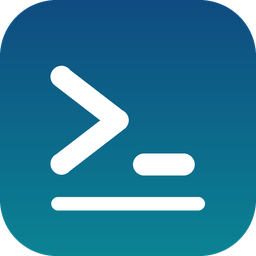
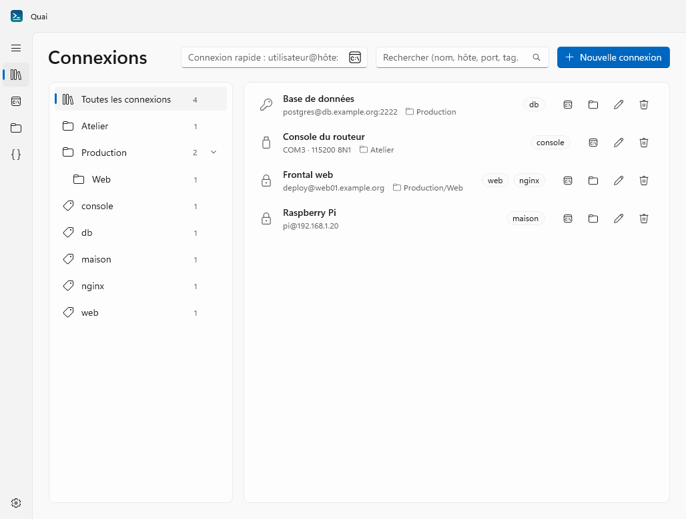
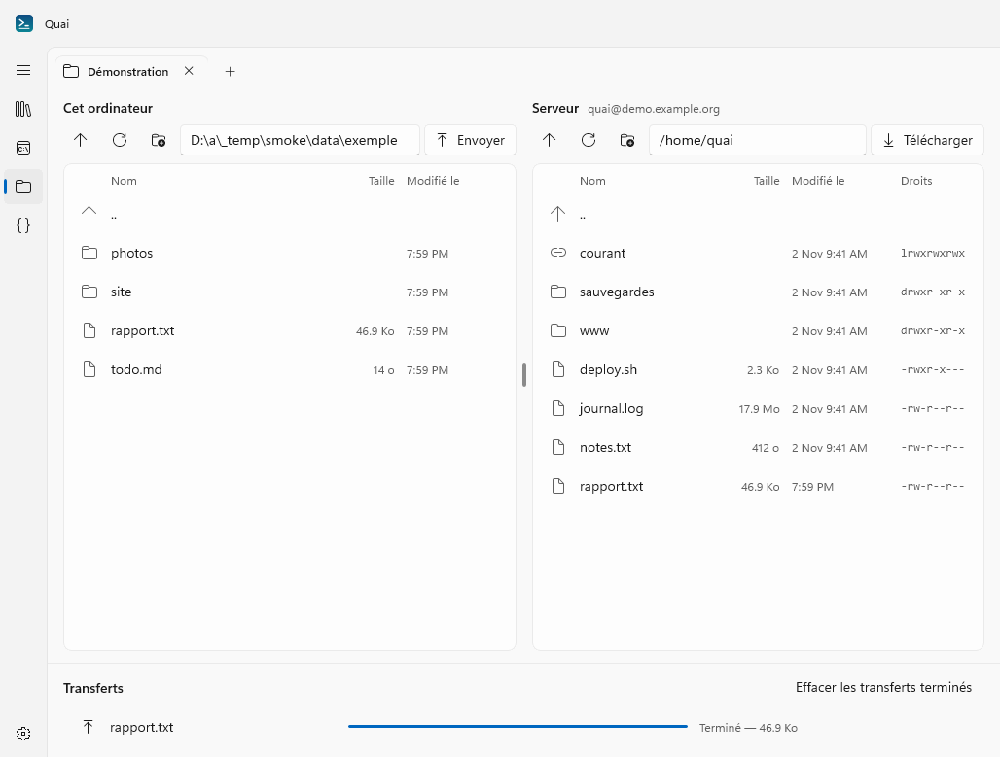

  

<h1 align="center">Quai</h1>

  <b>Vos serveurs, vos fichiers et vos appareils, réunis dans une seule application Windows.</b> 
  Un client SSH et SFTP moderne, simple et gratuit, pensé pour Windows 11.

  <a href="https://github.com/memton80/quai-ssh/releases/latest"><b>Télécharger Quai pour Windows</b></a>
  · Gratuit · Sans compte · Sans publicité

## Pourquoi Quai ?

Se connecter à un serveur ne devrait pas demander trois logiciels et un post-it couvert de mots de passe. Quai rassemble tout au même endroit, dans une fenêtre qui ressemble à Windows 11.

- **Tous vos serveurs, bien rangés.** Ajoutez une connexion une fois, retrouvez-la en un clic : dossiers, étiquettes et recherche instantanée.
- **Un vrai terminal, rapide et net.** Quai utilise le moteur de Windows Terminal, celui de Microsoft. Plusieurs onglets, copier-coller comme d'habitude.
- **Vos fichiers par glisser-déposer.** Votre PC à gauche, le serveur à droite : faites glisser, c'est envoyé. Un fichier de configuration à retoucher ? Ouvrez-le dans votre éditeur habituel, chaque enregistrement repart sur le serveur.
- **Moins de répétitions.** Connexion rapide sans fiche, commandes favorites envoyées en deux touches, explorateur ouvert directement dans le dossier où vous êtes, reconnexion automatique après une coupure ou une mise en veille.
- **Aussi pour vos petits appareils.** Routeur, switch, Arduino, Raspberry Pi : branchez le câble, choisissez le port, c'est parti.
- **Toujours à jour, en un clic.** Quand une nouvelle version sort, un bouton suffit : Quai se met à jour et redémarre tout seul.

## Vos secrets restent chez vous

- Vos mots de passe sont rangés dans le **coffre de Windows**, jamais dans un fichier.
- Quai vérifie l'identité de chaque serveur et vous **prévient** si elle change.
- **Aucune publicité, aucun pistage, aucun compte à créer.** Quai ne parle qu'à vos serveurs, et à GitHub pour savoir s'il existe une nouvelle version (désactivable).

## Installer Quai en une minute

1. Téléchargez **`Quai-Setup-x64.exe`** depuis la [dernière version](https://github.com/memton80/quai-ssh/releases/latest) (ou `Quai-Setup-arm64.exe` pour un PC Snapdragon / ARM).
2. Lancez-le : pas besoin d'être administrateur, tout est inclus.
3. C'est prêt : Quai vous attend dans le menu Démarrer.

> Au premier lancement, Windows peut afficher « Windows a protégé votre ordinateur » : Quai est un projet indépendant et ses fichiers ne sont pas encore signés. Cliquez sur **Informations complémentaires**, puis **Exécuter quand même**.

Fonctionne sur Windows 10 et Windows 11. Une version portable (zip, sans installation) est aussi proposée.

## Une alternative légère

Vous jonglez entre PuTTY, WinSCP, MobaXterm ou Termius ? Quai réunit l'essentiel dans une seule application, plus légère, en français, qui suit le thème clair ou sombre de Windows.

## En savoir plus

- [Le guide complet](docs/GUIDE.md) : toutes les fonctionnalités, les raccourcis clavier, où sont vos données, les limites actuelles.
- [Pour les développeurs](docs/DEVELOPPEMENT.md) : organisation du code, tests, compilation, publication.
- Une idée, un bug ? [Ouvrez un ticket](https://github.com/memton80/quai-ssh/issues).

Quai est gratuit et open source, sous licence MIT.
